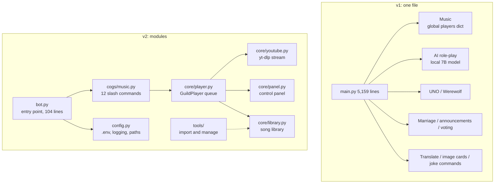
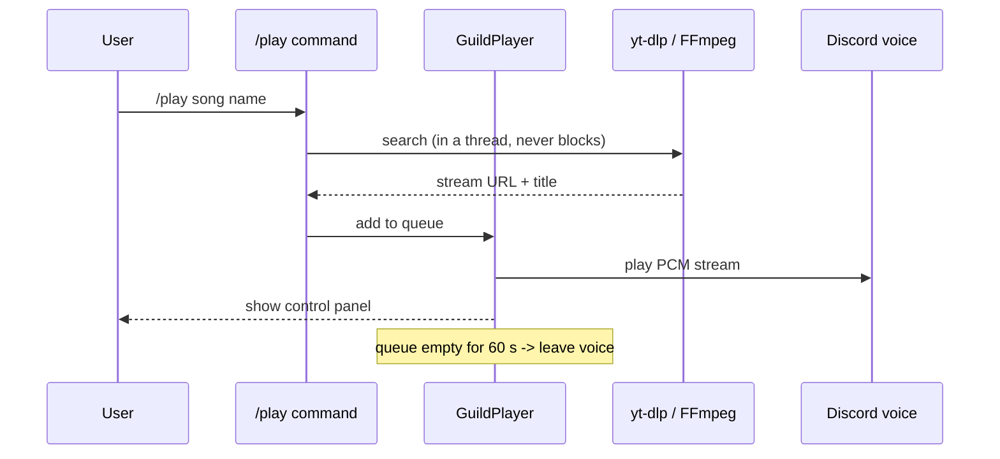
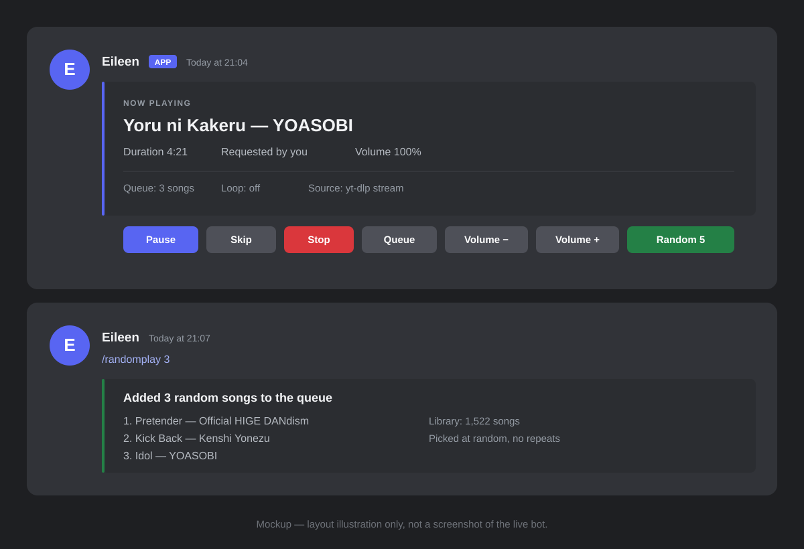

# Discord Music Bot — Two Generations (v1 → v2)

> A Discord bot that plays YouTube music in voice channels.
> It started as one 5,159-line file. Then I rewrote it into a small, modular project.


---

## Project Overview

This repo keeps **two versions** of the same bot.

| Version | What it is | Size |
| --- | --- | --- |
| **v1** ([`legacy/`](legacy/)) | One file with everything | 1 file, 5,159 lines, 73 commands |
| **v2** ([`v2/`](v2/)) | Rewrite. Music only. | 10 modules, 1,729 lines, 12 commands |

v2 is the version I use today. v1 is kept as a record of how the project grew.

The goal of this repo is not only to show working code. It also shows **one real rewrite**: what broke, what I changed, and what I gave up.

---

## Motivation

**At first, I only wanted a bot that plays songs.**

In late 2024, I wrote the first version for my own Discord server. It had two commands: `!mimic` (copy someone's avatar) and `!reset`. Less than 150 lines.

Then friends asked for more. "Can it play music?" So I added `/play`. "Can it pick a random song?" So I added `/randomplay`. "Can it run UNO?" So I added UNO.

Four months later, `main.py` had **5,159 lines and 73 commands**. It still worked. But nobody wanted to touch it.

The breaking point was a small bug: the bot disconnected when the song changed. I fixed it in three places and broke four other commands. That night I decided to rewrite.

Before I started, I asked myself one question: **how many of these 73 commands did I use this week?** The answer was three. All of them were music.

So v2 keeps music. Everything else is gone.

---

## Technologies

| Tech | Where it is used | Why I chose it |
| --- | --- | --- |
| **Python 3.12** | Everything | Large ecosystem. discord.py is mature. |
| **discord.py 2.x** | Bot framework | Native slash commands, UI buttons, voice playback |
| **yt-dlp** | Search and stream | Best tool for YouTube. Updates often. |
| **FFmpeg** | Audio conversion | Turns a stream into the PCM format Discord needs |
| **SQLite** | Song library (1,522 songs) | One file, no setup, easy to back up |
| **asyncio** | Concurrency | Many servers can play at the same time |
| **python-dotenv** | Config | Keeps the token out of git |
| **logging** | Debugging | Replaces 124 `print()` calls from v1 |
| **PowerShell / Batch** | Operations | Start, stop, run in background, read logs |

v1 also used `transformers` + `PyTorch` (a local 7B chat model), `Pillow` (image cards), `OpenCC` (Chinese conversion), `BeautifulSoup`, and `aiohttp`. v2 drops all of them.

---

## Features

### v2 (current)

| Command | What it does |
| --- | --- |
| `/play <song or URL>` | Play a YouTube song. A keyword works too. |
| `/search <keyword>` | Search YouTube and pick from the first 5 results |
| `/randomplay <1-5>` | Pick 1–5 random songs from the library |
| `/library` | Show how many songs are available |
| `/join` | Join your voice channel |
| `/pause` / `/resume` / `/skip` / `/stop` | Playback control |
| `/queue` / `/nowplaying` | Queue and current song |
| `/volume <0-200>` | Change volume |

Other behaviour:

- **Control panel**: a button row appears with the song (pause, skip, stop, queue, volume −/+, random 5). No need to remember commands.
- **One queue per server**: music in server A never touches server B.
- **Idle disconnect**: if the queue is empty for 60 seconds, the bot leaves the voice channel.
- **Silent replies**: every reply uses `silent=True`, so Discord does not send a notification.
- **Broken songs are marked**: if a video is removed or region-locked, the bot skips it and marks it, so `/randomplay` stops picking it.

### v1 (kept in `legacy/`)

73 commands: music, lyrics, an AI role-play chat (a local 7B model), UNO, Werewolf, a marriage system, announcements, voting, quote image cards, Chinese conversion, "today in history", riddles, rock-paper-scissors, and a few joke commands (`/tp`, `/kill`, `/summon`).

Full list: [`docs/02-command-list.md`](docs/02-command-list.md).

---

## Technical Challenges

### 1. Getting blocked by YouTube

YouTube does not want bots. When it sees many requests from one IP address, it can:

- return `403` or an empty result,
- show "Sign in to confirm you're not a bot",
- block the IP for hours.

v1 made this worse. It **downloaded every song as an mp3** before playing. That is one full download per song, plus search requests. With heavy use, the bot got blocked often, and a block meant music stopped for everyone.

### 2. Music disconnects and playback failures

Voice playback has many failure points:

- The voice connection drops (network loss, Discord restart).
- The FFmpeg process exits in the middle of a song.
- The stream URL expires, or the video is deleted while playing.
- FFmpeg hangs, so the bot waits forever and the queue stops.

In v1, the player was a global dict with no cleanup. A dead player stayed in memory, and the next `/play` sometimes reused it.

---

## Solutions

### 1. How I reduced YouTube blocks

| Change | Effect |
| --- | --- |
| **Stream instead of download** | No mp3 files, no disk writes, far fewer requests |
| **Ask YouTube only when needed** | One request to resolve the song, one more to get the stream URL. No prefetch, no bulk import, no playlist scans (`noplaylist`). |
| **Reuse the stream URL** | The URL from extraction is used for the whole song, not re-fetched every time |
| **Disable the yt-dlp cache** | `cachedir: False` avoids stale or locked cache files |
| **Browser user agent** | A normal Chrome user agent (see `core/youtube.py`) |
| **Short timeouts** | 45 s for search, 60 s for stream. A blocked request cannot freeze the bot. |
| **Mark, do not retry** | A broken video is marked `is_available = 0` and skipped. The bot never hammers YouTube in a loop. |
| **Keep yt-dlp updated** | YouTube changes often. `pip install -U yt-dlp` fixes most new errors. |

What I did **not** do: cookies, PO token, or a proxy. They work, but they add accounts and cost. They are listed in Future Development.

### 2. How I made playback stable

| Problem | Fix |
| --- | --- |
| Stream drops in the middle | FFmpeg reconnect flags: `-reconnect 1 -reconnect_streamed 1 -reconnect_delay_max 5` |
| Voice connection lost | Before each song, check `voice.is_connected()`. Try to reconnect once. If it fails, ask the user to run `/play` again. |
| FFmpeg hangs forever | Watchdog: if a song runs longer than `duration + 30` seconds, force stop and move to the next song |
| Song removed or private | Read the error text. Classify it (`private`, `deleted`, `copyright`), tell the user, and skip |
| Old player object stays | Every player is a `GuildPlayer` object. It is removed from `MusicManager` when the queue ends or the bot goes idle |
| Idle bot sits in the channel | Leave the voice channel after 60 s with no songs (`IDLE_DISCONNECT_SECONDS`) |
| Blocking yt-dlp calls | All yt-dlp and SQLite work runs in `asyncio.to_thread` / `run_in_executor`, so other servers keep playing |
| Thread callback crash | `_after_play` uses `call_soon_threadsafe` to wake the async loop safely |

The main idea: **every failure has an exit**. The bot never waits forever, and it never keeps a dead object.

---

## Screenshots

> The images below are diagrams and a mockup drawn to show the layout. They are not screenshots of the live bot.

### Architecture: v1 vs v2



### Play flow



### UI mockup



*A layout illustration, not a screenshot. It shows where the song info, the control buttons, and the `/randomplay` result appear.*

---

## Future Development

| Priority | Item | Note |
| --- | --- | --- |
| High | `/lyrics` | v1 had it. v2 does not. Easy to add. |
| High | Save the queue | The queue is lost on restart. A SQLite table would fix that. |
| High | Unit tests | `core/` is easy to test (song pick, time format, error check). Coverage is 0 today. |
| Medium | `/autoplay` | Play a related song when the queue is empty |
| Medium | Playlists and favourites | The library only supports random picks now |
| Medium | Docker | Replaces the Windows-only `.bat` and `.ps1` scripts |
| Medium | YouTube cookies or PO token | The next step if blocking gets worse |
| Low | More sources | Only YouTube today |
| Low | i18n | All messages are Chinese today |

v1 social features (marriage, nicknames, announcements) may come back later, but as separate cogs. They will not go back into the main file.

---

## Repository Structure

```text
.
├── README.md
├── docs/
│   ├── 01-version-comparison.md   ← full comparison of v1 and v2
│   ├── 02-command-list.md         ← 73 vs 12 commands
│   └── images/                    ← UI mockup (SVG)
├── legacy/                        ← v1 source (tokens removed)
│   ├── main.py                    ← 5,159 lines
│   ├── save*.py                   ← old snapshots
│   └── README.md
└── v2/                            ← current version
    ├── bot.py / config.py
    ├── cogs/music.py
    ├── core/{player,panel,library,youtube,randomplay}.py
    ├── tools/{import_legacy_songs,manage_music_db}.py
    ├── EileenControl.ps1 / *.bat
    └── README.md
```

---

## Quick Start

```powershell
git clone <this repo>
cd discord-bot-history\v2

copy .env.example .env     # add DISCORD_BOT_TOKEN and FFMPEG_PATH
setup.bat                  # create .venv and install packages
start.bat
```

You need Python 3.10+ and FFmpeg. Full steps (Discord app, permissions, common errors): [`v2/README.md`](v2/README.md).

For v1, see [`legacy/README.md`](legacy/README.md).

---

## Security

- All Discord tokens were removed from the code. The bot reads `DISCORD_BOT_TOKEN` from `.env`, and `.env` is in `.gitignore`.
- No runtime data is uploaded: no databases, logs, `cookies.json`, member name list, or media files.
- **Old tokens were stored in plain text in 6 files.** If that token is still active, reset it now in the Discord Developer Portal.

---

## License

Personal project. Code is free to read and reuse.
Third-party parts (discord.py, yt-dlp, FFmpeg) keep their own licenses.
All diagrams in this README are my own. No third-party images are used.
